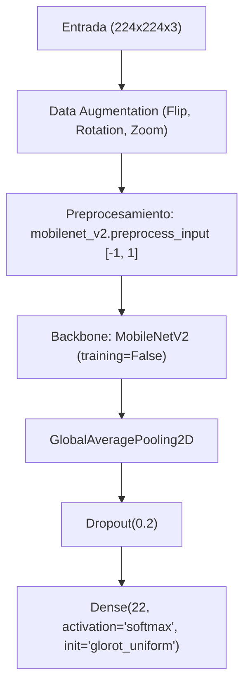

# Clasificación de Enfermedades en Hojas de Plantas con Transfer Learning (MobileNetV2)

Este repositorio contiene la solución para la clasificación multiclase de patologías y especies vegetales sobre el dataset masivo **`plant_leaves`**, aplicando **Transfer Learning (Aprendizaje por Transferencia)** y **Fine-Tuning (Ajuste Fino)** con una arquitectura profunda optimizada para dispositivos móviles (**MobileNetV2**).

---

## 📌 1. Descripción del Proyecto y Dataset

El diagnóstico oportuno de enfermedades foliares es fundamental para la seguridad alimentaria y la agricultura de precisión. Este proyecto aborda la clasificación automática de hojas saludables e infectadas utilizando visión por computadora.

* **Dataset:** [`plant_leaves`](https://www.tensorflow.org/datasets/catalog/plant_leaves) de TensorFlow Datasets (TFDS).
* **Volumen:** 4,502 imágenes distribuidas en **22 categorías** botánicas y patológicas.
* **Resolución cruda:** Imágenes de alta resolución ($4000 \times 6000$ píxeles), redimensionadas eficientemente a $224 \times 224 \times 3$.
* **Partición estratificada:**
  * **Entrenamiento (Train):** 80% ($\approx 3,601$ imágenes)
  * **Validación (Val):** 10% ($\approx 450$ imágenes)
  * **Prueba (Test):** 10% ($\approx 451$ imágenes)

---

## 🧠 2. Arquitectura del Modelo y Metodología

Para garantizar una inferencia rápida y ligera adecuada para aplicaciones en teléfonos móviles, se seleccionó **MobileNetV2** preentrenada sobre **ImageNet-1K**.



### Estrategia de Entrenamiento en 2 Fases:
1. **Fase 1 — Extracción de Características (*Feature Extraction*):**
   * El backbone `MobileNetV2` se congela por completo (`base_model.trainable = False`).
   * Se invoca con `training=False` para evitar que las capas de `BatchNormalization` actualicen sus estadísticas con lotes pequeños.
   * Se entrena únicamente el cabezal clasificador con optimizador `Adam(lr=1e-3)` y `EarlyStopping(patience=3)`.
2. **Fase 2 — Ajuste Fino (*Fine-Tuning*):**
   * Se descongelan las capas superiores profundas (`fine_tune_at = 100` en adelante).
   * Se recompila el modelo con una tasa de aprendizaje reducida ($100\times$ menor: `Adam(lr=1e-5)`) para adaptar representaciones de alto nivel sin destruir los pesos preentrenados.

---

## 📊 3. Evaluación y Métricas

* **Conjunto de prueba independiente:** Evaluado con `shuffle=False` para alinear predicciones con etiquetas verdaderas.
* **Métricas monitoreadas:** Exactitud (*Accuracy*) y pérdida categórica (*Sparse Categorical Crossentropy*).
* **Matriz de Confusión:** Matriz de $22 \times 22$ graficada con `ConfusionMatrixDisplay` para auditar el desempeño por clase.

---

## 📁 4. Estructura del Repositorio

```
Redes_neuronales_3_TL/
├── Leafs_plants.ipynb      # Notebook Jupyter interactivo con el pipeline completo
├── README.md               # Documentación general del repositorio
├── articulo_medium.md      # Borrador completo del artículo para publicación en Medium
```

---

## 🚀 5. Instrucciones de Reproducción Local

1. **Clonar el repositorio:**
   ```bash
   git clone https://github.com/oliveroide/Redes_neuronales_3_TL.git
   cd Redes_neuronales_3_TL
   ```

2. **Instalar dependencias necesarias:**
   ```bash
   pip install tensorflow tensorflow-datasets matplotlib numpy scikit-learn
   ```

3. **Ejecutar el Notebook:**
   ```bash
   jupyter notebook Leafs_plants.ipynb
   ```

---

## 🔗 6. Enlaces y Evidencias de Entrega

* **Repositorio en GitHub:** [https://github.com/oliveroide/Redes_neuronales_3_TL](https://github.com/oliveroide/Redes_neuronales_3_TL)
* **Artículo en Medium:** *(Enlace pendiente de publicación en Medium)*
* **Demostración en Video (App Móvil):** *(Enlace pendiente de video)*
