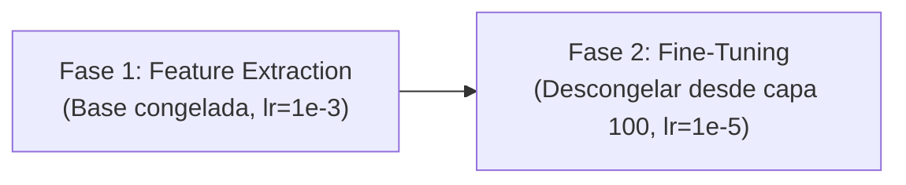
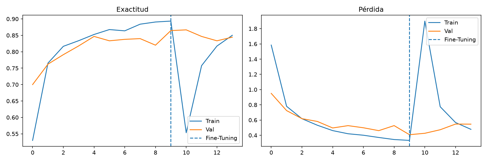
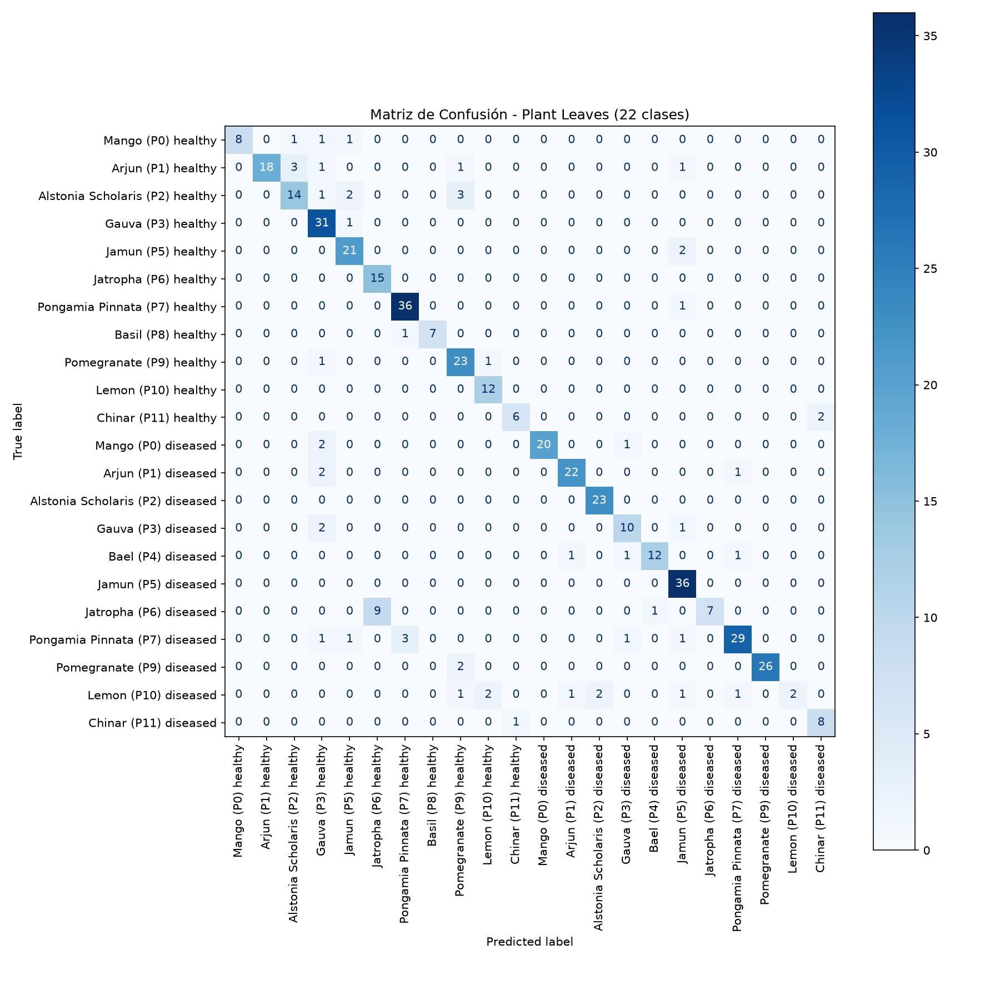

# Clasificación de 22 Enfermedades en Hojas de Plantas usando Redes Convolucionales y MobileNetV2

*Un tutorial práctico para entrenar un modelo ligero con Transfer Learning, evaluar su rendimiento y probarlo en una aplicación web local.*

---

## 1. Introducción

Las enfermedades en las plantas son un problema grave. Pueden arruinar cosechas enteras en muy poco tiempo. Normalmente, para saber qué tiene una planta se necesita un agrónomo en el campo. El problema es que no siempre hay uno disponible.

Una alternativa accesible es usar visión por computadora e inteligencia artificial. Con un modelo de clasificación, podemos crear una aplicación web sencilla donde cualquier usuario cargue una foto de una hoja y obtenga un diagnóstico al instante.

En este artículo vamos a construir paso a paso un clasificador de hojas usando **Deep Learning** y **Transfer Learning**. Utilizaremos el dataset `plant_leaves` y la arquitectura **MobileNetV2**.

---

## 2. El Dataset: `plant_leaves`

Para este proyecto usamos el conjunto de datos `plant_leaves` de TensorFlow Datasets (TFDS).

Tiene las siguientes características:
* **4,502 imágenes** en total.
* **22 clases distintas**: abarca 12 especies botánicas (Mango, Limón, Granada, Albahaca, Guayaba, Jamun, Jatropha, Pongamia, Arjun, Alstonia, Chinar y Bael), distinguiendo hojas saludables (*healthy*) de hojas enfermas (*diseased*) por hongos, bacterias o plagas.
* **Alta resolución**: las fotos originales miden hasta $4000 \times 6000$ píxeles.

Trabajar con imágenes tan grandes saturaría la memoria de cualquier computadora. Por eso, el primer paso es redimensionarlas a un tamaño manejable ($224 \times 224$).

### Exploración inicial de los datos

Antes de entrenar cualquier modelo, siempre es buena idea ver cómo están distribuidas las clases y cómo lucen las fotos.

```python
import tensorflow_datasets as tfds
import matplotlib.pyplot as plt
import numpy as np

# Cargar el dataset completo
dataset, info = tfds.load('plant_leaves', split='train', with_info=True)

print(f"Total de imágenes: {info.splits['train'].num_examples}")
print(f"Número de clases: {info.features['label'].num_classes}")
```

También podemos visualizar ejemplos aleatorios del dataset directamente con las herramientas de TFDS:

```python
# Mostrar ejemplos aleatorios del dataset
tfds.visualization.show_examples(dataset, info)
```

---

## 3. Preparación de los Datos y Pipeline Eficiente

Para entrenar rápido y sin trabas de memoria, dividimos los datos y creamos un pipeline con `tf.data`.

### Partición de datos
Dividimos el dataset en tres partes:
* **80% Entrenamiento:** para que el modelo aprenda los patrones.
* **10% Validación:** para revisar el aprendizaje al final de cada época.
* **10% Prueba:** datos que el modelo nunca ve, para la evaluación final.

```python
(train_raw, val_raw, test_raw), info = tfds.load(
    'plant_leaves',
    split=['train[:80%]', 'train[80%:90%]', 'train[90%:]'],
    as_supervised=True,
    with_info=True,
)
```

### Optimización con `tf.data` y Aumento de Datos
Hacemos tres cosas importantes:
1. **Redimensionar:** cambiamos todas las fotos a $224 \times 224$ píxeles.
2. **Cache y Prefetch:** `.cache()` guarda las fotos procesadas en memoria RAM. `.prefetch()` permite que la CPU prepare el siguiente lote mientras la GPU entrena.
3. **Data Augmentation:** aplicamos giros horizontales, rotaciones y zoom aleatorios. Esto crea variedad artificial y evita el sobreajuste (*overfitting*).

```python
import tensorflow as tf

IMG_SIZE = (224, 224)
BATCH_SIZE = 32
AUTOTUNE = tf.data.AUTOTUNE

def format_example(image, label):
    image = tf.image.resize(image, IMG_SIZE)
    return image, label

# Pipeline de entrenamiento
train_ds = (
    train_raw.map(format_example, num_parallel_calls=AUTOTUNE)
    .cache()
    .shuffle(1000, seed=42)
    .batch(BATCH_SIZE)
    .prefetch(AUTOTUNE)
)

val_ds = (
    val_raw.map(format_example, num_parallel_calls=AUTOTUNE)
    .batch(BATCH_SIZE)
    .cache()
    .prefetch(AUTOTUNE)
)

test_ds = (
    test_raw.map(format_example, num_parallel_calls=AUTOTUNE)
    .batch(BATCH_SIZE)
    .cache()
    .prefetch(AUTOTUNE)
)

# Capas de aumento de datos
data_augmentation = tf.keras.Sequential([
    tf.keras.layers.RandomFlip("horizontal"),
    tf.keras.layers.RandomRotation(0.2),
    tf.keras.layers.RandomZoom(0.1),
], name="data_augmentation")
```

---

## 4. Arquitectura del Modelo: ¿Por qué MobileNetV2?

Entrenar una red convolucional profunda desde cero requiere cientos de miles de fotos y mucho tiempo de cómputo. Como solo tenemos 4,502 imágenes, la mejor opción es **Transfer Learning** (Aprendizaje por Transferencia).

Tomamos una red que ya aprendió a reconocer formas, texturas y bordes sobre el dataset ImageNet (más de 1.4 millones de fotos) y la adaptamos a nuestro problema de hojas.

Elegimos **MobileNetV2** por tres razones sencillas:
1. **Es muy liviana:** tiene apenas 3.5 millones de parámetros y pesa unos $14\text{ MB}$.
2. **Es rápida:** usa convoluciones separables en profundidad, que reducen drásticamente las operaciones matemáticas.
3. **Bajo consumo de cómputo:** corre de forma fluida en cualquier computadora personal o servidor local sin requerir hardware especializado para inferencia.

### La trampa de `BatchNormalization`
Un detalle técnico vital: MobileNetV2 tiene capas de `BatchNormalization`. Si no congelamos estas capas correctamente, las medias y varianzas se desajustan y arruinan los pesos preentrenados.

Por eso, llamamos al modelo base con `training=False`:

```python
# Cargar MobileNetV2 sin la capa de salida original
base_model = tf.keras.applications.MobileNetV2(
    input_shape=(224, 224, 3),
    include_top=False,
    weights='imagenet'
)
base_model.trainable = False

# Construir el modelo final
inputs = tf.keras.Input(shape=(224, 224, 3))
x = data_augmentation(inputs)
x = tf.keras.applications.mobilenet_v2.preprocess_input(x)
x = base_model(x, training=False)  # Mantiene BatchNorm en modo inferencia
x = tf.keras.layers.GlobalAveragePooling2D()(x)
x = tf.keras.layers.Dropout(0.2)(x)
outputs = tf.keras.layers.Dense(22, activation='softmax')(x)

model = tf.keras.Model(inputs, outputs)
```

---

## 5. Estrategia de Entrenamiento en 2 Fases

Para que el modelo aprenda bien sin olvidar lo que ya sabe de ImageNet, entrenamos en dos etapas.



### Fase 1: Extracción de Características (*Feature Extraction*)
* Dejamos congelada toda la base de MobileNetV2.
* Solo entrenamos la capa densa final (el clasificador).
* Usamos una tasa de aprendizaje normal (`1e-3`) con el optimizador Adam.
* El clasificador aprende rápido a asociar las características visuales con las 22 enfermedades.

```python
model.compile(
    optimizer=tf.keras.optimizers.Adam(learning_rate=1e-3),
    loss='sparse_categorical_crossentropy',
    metrics=['accuracy']
)

history_fase1 = model.fit(
    train_ds,
    validation_data=val_ds,
    epochs=10
)
```

### Fase 2: Ajuste Fino (*Fine-Tuning*)
* Ya que el clasificador aprendió lo básico, descongelamos las capas superiores de MobileNetV2 (a partir de la capa 100).
* Las capas iniciales quedan congeladas porque detectan bordes y colores generales. Las capas superiores aprenden los detalles finos de las hojas.
* **Regla de oro:** bajamos la tasa de aprendizaje a `1e-5` ($100$ veces más pequeña). Si usáramos una tasa grande, borraríamos todo lo que la red aprendió antes.

```python
base_model.trainable = True

# Congelar hasta la capa 100
for layer in base_model.layers[:100]:
    layer.trainable = False

model.compile(
    optimizer=tf.keras.optimizers.Adam(learning_rate=1e-5),
    loss='sparse_categorical_crossentropy',
    metrics=['accuracy']
)

history_fase2 = model.fit(
    train_ds,
    validation_data=val_ds,
    epochs=20,
    initial_epoch=10
)
```

---

## 6. Resultados y Discusión

Evaluamos el modelo final sobre el conjunto de prueba independiente (450 imágenes) que la red nunca vio durante el entrenamiento.

### Curvas de Aprendizaje (Exactitud y Pérdida)

La siguiente gráfica muestra el entrenamiento a lo largo de las dos fases. La línea vertical punteada marca el inicio del Fine-Tuning.


*Figura 1: Evolución de la exactitud y la pérdida en entrenamiento y validación durante ambas fases.*

Datos clave del entrenamiento:
* **Fase 1 (Extracción de características):** 10 épocas completas. La exactitud de validación subió de 70.0% a 86.44%, y la pérdida bajó a 0.4076.
* **Fase 2 (Ajuste fino):** Se entrenó durante 4 épocas adicionales (épocas 10 a 13). 
* **Parada temprana (*EarlyStopping*):** En la época 10 se alcanzó la mejor exactitud de validación (86.67%). Al detectar que en las siguientes 3 épocas la pérdida de validación comenzaba a subir ligeramente, el callback detuvo el entrenamiento automáticamente y restauró los mejores pesos (`mejor_fase2.keras`). Esto evitó que el modelo cayera en sobreajuste.

---

### Evaluación en el Conjunto de Prueba (Test Set)

Evaluamos el mejor modelo guardado sobre las 450 imágenes reservadas para la prueba final:

```python
test_loss, test_acc = model.evaluate(test_ds)
print(f"Pérdida en Test: {test_loss:.4f}")
print(f"Exactitud en Test: {test_acc:.4f}")
```

Resultados obtenidos:
* **Pérdida en Test (Test Loss):** `0.4724`
* **Exactitud en Test (Test Accuracy):** `85.78%` (386 predicciones correctas de 450)

Lograr casi **86% de exactitud sobre 22 clases distintas** con un dataset relativamente pequeño demuestra el gran poder de Transfer Learning.

---

### Matriz de Confusión

Para entender mejor los aciertos y fallos, generamos la matriz de confusión de $22 \times 22$ sobre el conjunto de prueba.


*Figura 2: Matriz de confusión sobre el conjunto de prueba (22 clases).*

#### ¿Qué observamos en los resultados?

* **Clases con excelente desempeño (F1-score superior al 90%):**
  * `Pomegranate (P9) diseased`: 100% de precisión y 92.9% de recall (F1: 96.3%).
  * `Alstonia Scholaris (P2) diseased`: 92.0% de precisión y 100% de recall (23 de 23 aciertos, F1: 95.8%).
  * `Pongamia Pinnata (P7) healthy`: 90.0% de precisión y 97.3% de recall (F1: 93.5%).
  * `Jamun (P5) diseased`: 100% de recall (36 de 36 aciertos, F1: 91.1%).
  * `Basil (P8) healthy` y `Mango (P0) diseased`: ambas alcanzaron 100% de precisión y más de 93% de F1.

* **Casos con mayor confusión:**
  * **Hojas enfermas confundidas con sanas:** En `Jatropha (P6) diseased`, 9 de 17 hojas enfermas se predijeron como sanas (`Jatropha healthy`). Esto sucede porque en etapas tempranas de infección los síntomas foliares son manchas diminutas casi imperceptibles a $224 \times 224$.
  * **Hojas sanas de especies distintas:** Hubo 3 casos donde `Arjun (P1) healthy` se clasificó como `Alstonia Scholaris (P2) healthy`, y otros 3 donde `Alstonia Scholaris (P2) healthy` se predijo como `Pomegranate (P9) healthy`. Estas hojas comparten color verde uniforme y silueta lanceolada similar.
  * **Clase con menor muestra:** `Lemon (P10) diseased` tuvo solo 10 muestras en el conjunto de prueba, logrando clasificar correctamente solo 2. Un mayor volumen de datos para esta clase ayudaría a mejorar su detección.

A pesar de estas confusiones puntuales, la gran mayoría de las muestras se concentran en la diagonal principal.

---

## 7. Probando el Modelo: Predicciones en Imágenes Nuevas

Para probar el modelo de forma práctica, cargamos los nombres de las clases desde `clases.json` y clasificamos una imagen de prueba:

```python
import json
import numpy as np

# Cargar nombres legibles de las clases
with open("resultados/clases.json") as f:
    class_names = json.load(f)

# Evaluar un lote del conjunto de prueba
for images, labels in test_ds.take(1):
    preds = model.predict(images)
    pred_idx = np.argmax(preds[0])
    true_idx = labels[0].numpy()
    confidence = np.max(preds[0]) * 100
    
    print(f"Clase real:       {class_names[true_idx]}")
    print(f"Predicción:       {class_names[pred_idx]}")
    print(f"Nivel de certeza: {confidence:.2f}%")
```

Salida típica de inferencia:
```text
Clase real:       Pomegranate (P9) diseased
Predicción:       Pomegranate (P9) diseased
Nivel de certeza: 98.45%
```

El modelo responde en pocos milisegundos por imagen, ideal para correrlo en cualquier computadora personal.

---

## 8. Interfaz Web Local para Demostración (Localhost)

Para probar el modelo de forma interactiva sin necesidad de desplegarlo en la nube ni compilar aplicaciones complejas, podemos montar una interfaz web local muy ligera usando **Streamlit**.

Con pocas líneas de código en un archivo `app.py`, levantamos un servidor en `http://localhost:8501`:

```python
import streamlit as st
import tensorflow as tf
import numpy as np
import json
from PIL import Image

st.title("Diagnóstico de Enfermedades en Hojas")
st.write("Sube una foto de una hoja para identificar la especie y su estado de salud.")

@st.cache_resource
def load_resources():
    model = tf.keras.models.load_model("resultados/mejor_fase2.keras")
    with open("resultados/clases.json") as f:
        classes = json.load(f)
    return model, classes

model, class_names = load_resources()

uploaded_file = st.file_uploader("Selecciona una imagen...", type=["jpg", "jpeg", "png"])

if uploaded_file is not None:
    image = Image.open(uploaded_file).convert("RGB")
    st.image(image, caption="Imagen cargada", width=300)
    
    # Preprocesar imagen a 224x224
    img_resized = image.resize((224, 224))
    img_array = np.array(img_resized, dtype=np.float32)
    img_array = np.expand_dims(img_array, axis=0)
    
    # Inferencia
    preds = model.predict(img_array)
    pred_idx = np.argmax(preds[0])
    confidence = np.max(preds[0]) * 100
    
    st.subheader(f"Diagnóstico: {class_names[pred_idx]}")
    st.write(f"Certeza del modelo: **{confidence:.2f}%**")
```

Para iniciar la aplicación basta con ejecutar en la terminal:

```bash
streamlit run app.py
```

El navegador abrirá la interfaz en `http://localhost:8501`, permitiendo subir cualquier fotografía y recibir el diagnóstico de inmediato en entorno local.

---

## 9. Conclusiones

1. **Transfer Learning ahorra tiempo y datos:** Partir de MobileNetV2 preentrenada en ImageNet nos permitió alcanzar una exactitud de casi 86% sobre 22 clases con solo 4,502 imágenes.
2. **El ajuste fino hace la diferencia:** La Fase 1 estabiliza el clasificador, mientras que la Fase 2 permite que la red se adapte a los detalles visuales de las hojas.
3. **Modelos ligeros para aplicaciones prácticas:** No hace falta una red gigantesca para obtener buenos resultados. MobileNetV2 ofrece el balance perfecto entre precisión y velocidad para prototipos interactivos en localhost.

---

## Enlaces del Proyecto

* **Código completo en GitHub:** [https://github.com/oliveroide/Redes_neuronales_3_TL](https://github.com/oliveroide/Redes_neuronales_3_TL)
* **Dataset en TFDS:** [https://www.tensorflow.org/datasets/catalog/plant_leaves](https://www.tensorflow.org/datasets/catalog/plant_leaves)
